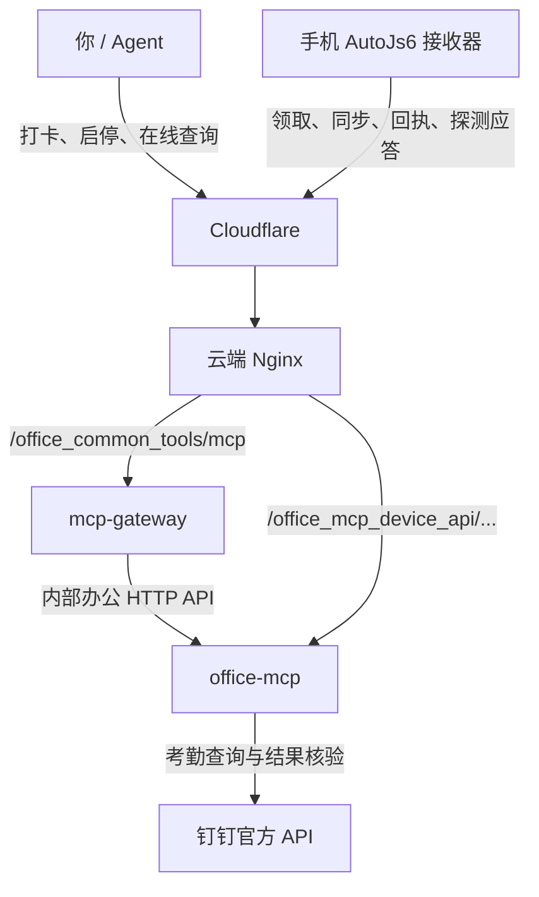
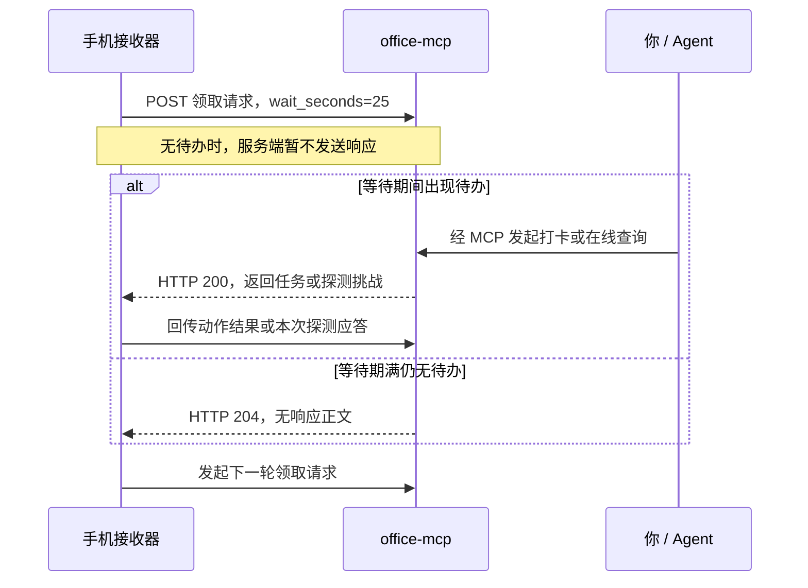

# Office HTTP API

通用办公 HTTP 服务，目标框架 `net8.0`，提供钉钉考勤查询、按打卡时间筛选的加班统计及手机远程打卡。服务端与 `mcp-gateway` 部署在同一台 Linux 云服务器，由 systemd 托管；手机通过公网 HTTPS 独立通信。开发电脑用于维护源码、构建和测试，不参与打卡运行链路。[架构与接口约定](docs/architecture.md)说明了模块边界。

AutoJs6 远程打卡与上午本地定时打卡共用持久化 Task 和钉钉 API 核验。定时动作后由常驻接收器上报执行事实、取回结果并写入手机日志，断网只补传事实，不重做动作。手机部署见 [定时与远程打卡说明](autojs6/README.md)，当前部署和运维见 [部署说明](docs/deployment.md)。

手机在主动／被动打卡取得终态后请求返回桌面，保留钉钉后台；始终未取得结果时，启动钉钉三分钟后也会请求桌面，补报与核验继续。现有保亮仍为 15 秒，熄屏收尾不再次唤醒；新动作会使旧收尾失效，避免延迟回执切走新任务。规则、日志和升级要求见 [返回桌面开发目标](docs/clock-in-return-home-prd.md)。

被动自动打卡支持远程开关：`attendance_automation_set` 对应 `POST /api/attendance/automation`，显式传 `enabled`、UUID `request_id`，可选 `wait_seconds`（默认 45）。`attendance_automation_status` 对应同路径 GET。关闭禁止新规划并取消待执行子任务；开启从下一次原定主任务恢复，不补建当天计划，主动打卡和已发生动作的核验不受影响。手机断网沿用本地最后状态，只有 `sync_state=applied` 才代表当前 `desired_enabled` 已在手机生效；HTTP 202 表示仍待同步。规则与持久化边界见 [开发目标](docs/scheduled-clock-in-control-prd.md)。

所有工具共用 [全项目时间规范](docs/time-conventions.md)：完整时间统一为 `yyyy-MM-ddTHH:mm:ss+08:00`，包括 full 明细；不返回 `time_zone`。纯日期仍为 `yyyy-MM-dd`，每日作息时刻带 `+08:00`，时长保持数字。

## 手机独立通过公网 HTTPS 通信

将手机接收器配置为 `base_url=https://mcp.example.com/office_mcp_device_api`，即可通过普通互联网与云端通信，不需要办公电脑、ADB 或手机 ZeroTier。先按 [公网设备入口部署步骤](docs/deployment.md#手机公网-https-设备入口)配置 Nginx，再更新唯一接收器及本地连接配置。

该路径仅代理设备领取、回执、补报、开关同步、任务结果及探测应答；复用现有 HTTPS 入口，不增加公网端口。手机继续使用独立的 `X-Device-Id`／`X-Device-Key`，不使用 MCP 网关 OAuth、网关密钥或办公 API Key。原无路径私网配置继续兼容，同一接收器只连接一个配置入口。方案与验收见 [手机公网 HTTPS 开发约定](docs/device-public-https-prd.md)。

### 网络请求流向

以下箭头表示请求的发起方向，HTTP 响应沿原路返回。手机主动向设备 API 领取任务、同步配置和回传结果；服务器不需要向手机建立入站连接，手机也不需要监听端口。



- Agent 的 MCP 请求经过网关，使用原 OAuth 或该 MCP 端点的 Bearer 凭据；网关再使用办公 API Key 访问 `office-mcp`。
- 手机的设备 API 请求由 Nginx 直接代理到 `office-mcp`，不经过 MCP 网关，使用手机自己的设备凭据。
- 公网配置下，领取、回执、开关同步、执行事实补报、任务结果查询及在线探测应答都走同一个 HTTPS 入口。没有同时通过 ZeroTier 领取任务，也没有失败后自动切换到私网的逻辑；保留私网地址兼容能力不代表双通道并行运行。

### 打卡、启停和在线查询如何到达手机

三类操作都由手机发起请求取得数据，但服务端保存的数据及手机处理方式不同：

| 操作 | 服务端处理 | 手机取得数据与确认 |
|---|---|---|
| 主动远程打卡 | 创建持久化打卡 Task，记录动作、有效期和核验状态 | 长轮询领取任务 → 亮屏、拉起钉钉 → 回传动作结果 → 服务端调用钉钉官方 API 核验考勤 |
| 启用／关闭自动打卡 | 保存目标开关与版本号，不创建可领取的打卡动作 | 独立同步请求取得配置 → 手机保存并应用 → 上报已应用版本；`sync_state=applied` 才表示当前设置已在手机生效 |
| 查询设备是否在线 | 创建有期限的临时内存挑战，不创建持久化打卡 Task | 长轮询收到挑战 → 另发 HTTPS 请求回传挑战 ID → 服务端收到本次匹配应答才返回 `online=true` |

关闭自动打卡不停止接收器，手机仍能收到重新开启的设置和主动打卡命令。在线查询只验证一次通信往返，不亮屏、不打开钉钉，也不把历史心跳当作本次应答。

### HTTP 长轮询如何等待任务

手机到设备 API 这一段采用 **HTTP Long Polling（HTTP 长轮询）**，由普通 HTTPS 请求及服务端的延迟响应逻辑实现，不使用 WebSocket 或 SSE。客户端延长超时还不够，服务端领取接口必须配合等待；本项目的等待逻辑见 [领取接口实现](src/OfficeMcp.Api/Features/DeviceCommands/DeviceCommandEndpoints.cs)。



1. 请求到达时已有可领取的任务或挑战，直接返回 `200 + JSON`；打卡任务优先于探测挑战。
2. 无待办时，服务端每 500 毫秒异步检查一次。等待期间出现可领取的数据，就提前返回，本轮请求结束，不必等满 25 秒。
3. 等待期满仍无待办，返回 `204 No Content`。手机继续接收循环，完成开关同步、待回执重传及必要的结果查询后，再发起领取请求。

25 秒是单次请求的最长等待时间，不是固定的任务采样窗口。有效待领任务即使产生在两轮请求的间隔，也能在下一轮被领取；已过期任务不会因恢复联网重新执行。探测挑战只在本次在线查询期限内有效，开关配置则由独立同步接口取得。

领取接口允许 `wait_seconds=0～25`。接收器通常使用 25 秒，有本地核验或收尾结果待查询时缩短为 5 秒；领取请求的客户端读取超时为 35 秒，Nginx 代理读取超时为 40 秒，为等待和网络传输留出余量。HTTP Keep-Alive 用于复用底层连接，与接口等待多久再返回是不同机制。

下面是一次领取请求的 cURL 示例（Bash），使用示例域名和测试设备。领取成功会占用对应待办，测试时不要与生产手机共用设备身份：

```bash
curl -i --max-time 35 \
  -X POST \
  'https://mcp.example.com/office_mcp_device_api/devices/demo-phone/commands/lease' \
  -H 'Content-Type: application/json' \
  -H 'X-Device-Id: demo-phone' \
  -H 'X-Device-Key: <测试设备密钥>' \
  --data '{"wait_seconds":25}'
```

`wait_seconds` 是本服务实现的等待参数；`--max-time 35` 是 curl 对整个请求的超时限制，`-i` 用于显示响应状态和头部。这条命令只完成一轮领取。未声明 `supports_probe` 时不返回在线挑战；实际接收器会发送 `supports_probe=true`，收到挑战后立即调用独立 ACK 接口。

接收器连接失败时按 2、4、8、16、30 秒退避重试，始终重试原配置入口。“连接已恢复”在下一次领取请求成功返回后才打印；日志间隔可能包含退避和长轮询等待，不能据此判断整个间隔都处于断网，也不代表发生了公网／ZeroTier 切换。长轮询机制参考 [RFC 6202](https://www.rfc-editor.org/rfc/rfc6202.html)。

### 关闭 ZeroTier 与断网的影响

使用公网配置时，只要普通 Wi-Fi／移动网络可访问公网服务、AutoJs6 正常运行，关闭手机 ZeroTier 不影响任务通信。本地定时计划读取手机最后已保存的开关状态，不要求每次先联网取得许可；公网断开会影响远程任务领取、开关同步、执行事实回传及结果查询，钉钉实际记录打卡仍需要联网。远程修改开关尚未被手机确认时，手机继续沿用上次已应用的状态。

## 实时查询打卡设备在线状态

远程打卡前需要确认手机通信是否可用时，调用只读工具 `attendance_device_status`，或：

```http
GET /api/attendance/device-status?wait_seconds=10
X-Api-Key: <本服务的 API Key>
```

`wait_seconds` 可省略，默认 10 秒，范围 1～30；收到手机对本次独立挑战的应答即提前返回。接口不亮屏、不打开钉钉、不创建打卡 Task、不改自动开关。

- `online=true`、`status=online`：本次往返成功，设备在 `checked_at` 时通信可用。
- `online=false`、`status=probe_timeout`：期限内没有收到本次应答，不能确认可用。所选通道网络断开、接收器未运行或未升级，以及正在执行动作／重试回执，都可能导致超时；旧私网配置还可能受 ZeroTier 断开影响，结果不区分故障原因。
- `device_id` 为已配置的打卡手机；`started_at`、`checked_at` 为秒级北京时间；`elapsed_ms` 包含等待领取的时间，不是网络 RTT。成功不保证稍后的连接或打卡结果。

`attendance_automation_status`、`attendance_automation_set` 不再返回 `device_online`：它们只描述开关和同步确认，`sync_state=applied` 表示手机已确认当前版本，`applied_at` 是确认时间，均不证明此刻在线。实时通信请调用 `attendance_device_status`。打卡 Task 的同名字段暂不调整，仍表示最近 60 秒内连接过。移除此字段需更新后端并刷新网关定义，已经升级的手机无需再更新；详见 [部署说明](docs/deployment.md#自动开关响应移除旧在线字段)。

## 部署方式

- Linux 示例服务目录为 `/opt/office-mcp`，服务名为 `office-mcp.service`，按实际环境调整。
- gateway、Nginx 与后端同机，通过 `127.0.0.1:18101` 访问后端，不需要把该业务端口直接暴露到公网。
- 手机通过 `/office_mcp_device_api/` 公网 HTTPS 入口访问设备接口；`mcp.example.com` 为占位域名，使用前必须替换。原私网地址仅保留协议兼容，不是现行部署的前置条件。
- 使用 `scripts/publish-linux.ps1` 发布 Linux 自包含程序；升级保留 `appsettings.Local.json` 和 `data/device-commands`。
- 服务账号只需读取程序和私密配置、读写状态目录；默认状态目录包含打卡任务、去重记录、锁文件及 `automation/state.json` 开关状态。

## 本地启动

在项目根目录执行：

```powershell
dotnet run --project src/OfficeMcp.Api
```

默认仅监听 `http://127.0.0.1:18101`。首次启动前，将 `deploy/appsettings.Local.example.json` 复制为 `src/OfficeMcp.Api/appsettings.Local.json`，填写自己的钉钉凭据、API Key 和固定用户 ID。该文件被 Git 忽略，构建时复制到程序目录，发布时不复制。

新环境可从 `deploy/appsettings.Local.example.json` 复制到程序目录并填写凭据。配置按下列顺序覆盖：基础配置、环境配置、本机配置、环境变量、命令行。修改本机配置后重启生效。也可以使用环境变量：

| 配置 | 环境变量 | 用途 |
|---|---|---|
| `Authentication:ApiKey` | `Authentication__ApiKey` | 后端独立认证密钥，32 至 512 字符 |
| `DingTalk:ClientId` | `DingTalk__ClientId` | 钉钉 Client ID / AppKey |
| `DingTalk:ClientSecret` | `DingTalk__ClientSecret` | 钉钉 Client Secret / AppSecret |
| `DingTalk:TimeoutSeconds` | `DingTalk__TimeoutSeconds` | 单次钉钉 HTTP 超时，默认 15 秒 |
| `Attendance:UserId` | `Attendance__UserId` | 默认查询员工及主动打卡固定员工，必须由部署环境填写 |
| `Attendance:MaxQueryDays` | `Attendance__MaxQueryDays` | 单次范围上限，默认 31 天，可配置为 1 至 366 天 |
| `Attendance:MaxParallelDays` | `Attendance__MaxParallelDays` | 同时查询的七天分段数，默认 3，可配置为 1 至 8；保留原配置名称 |
| `Attendance:QueryTimeoutSeconds` | `Attendance__QueryTimeoutSeconds` | 整次查询超时，默认 120 秒，可配置为 1 至 210 秒 |
| `Urls` | `Urls` | Kestrel 监听地址，多个地址用分号分隔 |

本接口无需 App ID、AgentId。钉钉应用需具备考勤读取权限，且所查员工在可访问范围内。员工列表与姓名查询还需要部门和员工通讯录读取权限。

## 查询接口

```http
GET /api/attendance?start_date=2026-09-10&end_date=2026-09-11
X-Api-Key: <本服务的 API Key>
```

可选入参：`user_id` 与 `user_name` 二选一；都不填时使用默认员工。姓名去除首尾空白后精确匹配；不存在返回 404，重名返回 409，并在 `details.candidates` 提供 ID、姓名和部门，选定 ID 后重试。

`detail` 默认 `simple`，返回打卡摘要。设为 `full` 时，每条 `records` 增加 `details`，保留 `/attendance/listRecord` 的完整字段，已知时间字段通过共用工具转换为可读北京时间，非时间值保持原样，包括实际返回的地址、经纬度、设备、Wi-Fi、记录 ID 等；原始明细中的员工 ID 也保持完整。未返回的字段不会补造；摘要与明细时间采用同一固定格式，明细中的数字时间戳不再原样输出。

```http
GET /api/attendance?start_date=2026-09-01&end_date=2026-09-14&user_id=test-user-000001&detail=full
X-Api-Key: <本服务的 API Key>

GET /api/employees?user_name=张
X-Api-Key: <本服务的 API Key>
```

`employee_list` 对应 `GET /api/employees`，返回员工数组，字段为 `user_id`（完整 ID）、`name`、`departments`（`dept_id`、`name`）。内部通过 `/topapi/v2/user/list` 分页，并以 `/topapi/v2/department/listsub` 遍历应用可见的部门和子部门；跨部门员工按 ID 去重并合并部门。可选 `user_name` 为姓名包含筛选，省略时返回完整可见目录。完整目录缓存五分钟；任何分页或部门读取失败均返回错误，不使用半份目录判断姓名唯一性。

从本机配置读取密钥并请求，不在命令或输出中直接展示密钥：

```powershell
$officeConfig = Get-Content ./src/OfficeMcp.Api/appsettings.Local.json -Raw | ConvertFrom-Json
$officeHeaders = @{ 'X-Api-Key' = $officeConfig.Authentication.ApiKey }
$officeResult = Invoke-RestMethod 'http://127.0.0.1:18101/api/attendance?start_date=2026-09-10&end_date=2026-09-11' -Headers $officeHeaders -TimeoutSec 150
ConvertTo-Json -InputObject $officeResult -Depth 6
```

考勤响应是按日期升序排列的数组，每天恰好一个结果。以下片段展示成功和失败日期的结构（同一失败分段中的日期均失败，示例时间和错误为虚构值）：

```json
[
  {
    "work_date": "2026-09-10",
    "user_id": "tes**********001",
    "records": [
      {
        "check_type": "OnDuty",
        "check_type_name": "上班",
        "planned_check_time": "2026-09-10T09:00:00+08:00",
        "actual_check_time": "2026-09-10T08:58:00+08:00",
        "status_code": "Normal",
        "status": "正常"
      }
    ],
    "success": true
  },
  {
    "work_date": "2026-09-11",
    "user_id": "tes**********001",
    "records": [],
    "success": false,
    "error": {
      "code": "dingtalk_api_error",
      "message": "钉钉拒绝了业务请求，请检查应用权限、用户可见范围和上游错误码。",
      "provider_code": "60011"
    }
  }
]
```

起止日期必须是有效的 `yyyy-MM-dd`，包含首尾日期，开始日期不能晚于结束日期，默认最多 31 天。单日查询将两个日期传成相同值，仍返回长度为 1 的数组。原单天入参 `work_date` 已替换为 `start_date`、`end_date`；响应中每个日期的 `work_date` 字段保留。

考勤摘要的 `user_id` 只展示首尾各 3 位，中间逐位替换为 `*`；长度不超过 6 位时全部隐藏。按姓名查询时还返回所选 `user_name`。接口按上游 `workDate` 归属工作日，保留同一时段的不同流水及跨午夜记录，不计算工时；相同记录 ID 仅保留较新版本。缺少打卡时间为 `null`，不自行补造缺卡记录。`success: true` 且 `records: []` 表示当天没有明细；`success: false` 表示查询失败，应读取 `error`，不能据此判断休息或旷工。

服务调用 `/attendance/listRecord`，按最多七个自然日分段，默认同时查询三段；一段失败时，该段日期均标记失败，其他段继续查询。整次查询默认 120 秒超时（含姓名解析），保留已完成段，并将尚未完成或尚未请求的日期标记为 `attendance_query_timeout`。姓名尚未解析完成即超时则返回 HTTP 504。客户端断开连接时取消后续工作。调用方可只对失败日期重试。

| HTTP 状态 | 含义 |
|---|---|
| 200 | 范围查询结果数组；逐日检查 `success`，可能部分或全部失败 |
| 400 | 日期或选择参数无效、重复参数、范围超限、ID 与姓名同时填写、未知 detail |
| 401 | API Key 缺失或不正确 |
| 404 / 409 | 姓名不存在 / 姓名重复，需要选择候选 ID |
| 502 / 504 | 员工目录读取失败 / 目录或姓名解析超时 |
| 500 | 服务内部错误 |

参数校验、认证、员工解析及内部错误采用 `application/problem+json`。考勤分段的业务错误、网络失败、损坏响应、用户不匹配和超时放入对应日期的 `error`，含 `code`、`message` 及可用的 `provider_code`，不会丢弃其他分段的成功结果。单次 HTTP 超时使用 `dingtalk_timeout`，整次范围查询超时使用 `attendance_query_timeout`。

## 加班日期与时长查询

`GET /api/attendance/overtime` 对应只读 MCP 工具 `attendance_overtime`。入参与 `attendance_query` 相同：`start_date`、`end_date` 必填，`user_id`／`user_name` 二选一或均省略，`detail` 为 `simple`／`full`。复用一次原考勤查询，保留七天分段、姓名消歧、日期上限和原明细；另通过钉钉原生 `getattcolumns` 动态发现休息天数列，再用 `getcolumnval` 查询日期安排，报表最多 31 天一段，与考勤共用单次查询时间预算。

原考勤工具返回所有日期；加班工具的 `days` 返回符合规则的加班日和分类未知的待核验出勤，保留每天全部 `records`。`day_type` 为 `workday`、`non_workday` 或 `unknown`，`classification` 说明钉钉原生休息安排，`overtime_confirmed` 表示是否按本工具规则确认，`anomalies` 明示缺卡、未知类型和时间逆序。

工作日仍取最晚实际 `OffDuty` 应用配置门槛；非工作日（包括该员工安排休息的节假日）有任意记录即返回，不要求 21:00 或上下班卡齐全。完整卡从最早 `OnDuty` 至最晚 `OffDuty` 计时；缺卡及无法核算时长返回 null，不能用零或排除日期代替。分类失败也保留记录，`day_type=unknown`、`overtime_confirmed=null`，不计入已确认汇总。没有实际时间的原始记录同样保留异常，但不称为已确认出勤。普通休息与法定节假日不能仅凭休息标记细分，原生加班列为零也不代表没有实际出勤。完整目标见 [非工作日加班补齐](docs/overtime-non-workday-prd.md)。

默认配置：

```json
"Overtime": {
  "WorkStartTime": "09:00",
  "WorkEndTime": "18:00",
  "ThresholdTime": "21:00"
}
```

这三个时间可以在 `appsettings.Local.json` 中覆盖，或使用 `Overtime__WorkStartTime`、`Overtime__WorkEndTime`、`Overtime__ThresholdTime` 环境变量；修改后重启生效。必须满足同一日内上班 < 下班 <= 门槛。上班时间只用于展示规则，不改变原迟到／早退状态或手机定时。

**工作日实际下班时间达到 21:00:00 即计加班，达到门槛后从 18:00 开始计时。** 20:59:59 不计，21:00 计 3 小时，21:30 计 3.5 小时。非工作日不应用这些时刻，`normal_work_start`、`normal_work_end`、`threshold_at` 为 null；其 `duration_basis=first_on_to_last_off`，09:00 至 18:00 的完整卡计 9 小时。跨午夜均按原 `work_date` 归属。不扣餐休或按整点取整；秒数保留时间差精度，小时数四舍五入到两位，合计小时从已知总秒数换算，不累加逐日舍入值，也不代表钉钉审批认定的时长。

返回结构示例（合成数据）：

```json
{
  "start_date": "2026-09-10",
  "end_date": "2026-09-10",
  "rule": {
    "work_start_time": "09:00:00+08:00",
    "work_end_time": "18:00:00+08:00",
    "threshold_time": "21:00:00+08:00",
    "threshold_inclusive": true,
    "duration_basis": "work_end",
    "non_workday_inclusion": "any_record",
    "non_workday_duration_basis": "first_on_to_last_off",
    "unknown_classification_policy": "return_for_review"
  },
  "days": [
    {
      "work_date": "2026-09-10",
      "user_id": "tes**********001",
      "records": [
        {
          "check_type": "OffDuty",
          "check_type_name": "下班",
          "planned_check_time": "2026-09-10T18:00:00+08:00",
          "actual_check_time": "2026-09-10T21:30:00+08:00",
          "status_code": "Normal",
          "status": "正常"
        }
      ],
      "overtime": {
        "normal_work_start": "2026-09-10T09:00:00+08:00",
        "normal_work_end": "2026-09-10T18:00:00+08:00",
        "threshold_at": "2026-09-10T21:00:00+08:00",
        "last_off_duty_at": "2026-09-10T21:30:00+08:00",
        "overtime_seconds": 12600,
        "overtime_hours": 3.5,
        "first_on_duty_at": null,
        "duration_basis": "work_end",
        "duration_status": "calculated"
      },
      "day_type": "workday",
      "overtime_confirmed": true,
      "inclusion_reason": "workday_threshold",
      "classification": { "status": "confirmed", "source": "dingtalk_report", "is_non_workday": false },
      "anomalies": [{ "code": "missing_on_duty", "message": "缺少有效上班打卡，已保留全部记录。" }],
      "success": true
    }
  ],
  "summary": {
    "overtime_days": 1,
    "total_overtime_seconds": 12600,
    "total_overtime_hours": 3.5,
    "returned_days": 1,
    "unconfirmed_days": 0,
    "duration_unconfirmed_days": 0,
    "anomalous_days": 1,
    "duration_complete": true
  },
  "complete": true,
  "errors": []
}
```

当 `complete=true` 且 `days=[]` 时，表示范围内没有满足规则或待核验的出勤日期。考勤／所需分类查询失败时 `complete=false`，`errors` 逐日说明安全错误；分类未知仍返回已有记录。`summary.overtime_days` 包括确有非工作日打卡的缺卡日期，`returned_days` 包括待核验候选；`unconfirmed_days` 和 `duration_unconfirmed_days` 分别说明未确认加班与已确认但缺时长的天数。总时长仅合计已确认且能核算的部分，必须同时检查 `duration_complete`。缺卡可以使时长不完整而查询仍完整，不能将 `complete=true` 等同于时长齐全。HTTP 鉴权、参数和姓名解析错误沿用原考勤接口。

## Linux 发布与服务运维

在开发环境使用能构建 `net8.0` 的 .NET SDK 和 PowerShell 执行发布脚本；产物携带 Linux x64 运行时，服务器不需要另行安装 SDK 或共享运行时。

当前项目仍为 `net8.0`，发布脚本默认携带运行时 `8.0.31`。.NET 8 已于 2026-11-10 结束支持，详见 [.NET 官方支持策略](https://dotnet.microsoft.com/en-us/platform/support/policy/dotnet-core)。框架升级需要同步项目、发布脚本和回归验证，不能仅修改文档中的版本号。

```powershell
# 生成 artifacts/publish-linux-x64 下的自包含程序，不包含私密配置或业务状态。
./scripts/publish-linux.ps1
```

首次部署按 [Linux 后端步骤](docs/deployment.md#linux-后端)配置独立服务账号、私密配置及 [systemd 服务模板](deploy/linux/office-mcp.service)。按实际安装目录调整服务模板，启动前创建并授权 `data` 状态目录；手机独立设备入口另外按 [Nginx 部署步骤](docs/deployment.md#手机公网-https-设备入口)配置。

升级前备份既有程序、私密配置和状态目录，再停止云端后端：

```bash
sudo systemctl stop office-mcp.service
```

用新发布产物替换程序，保留已有 `appsettings.Local.json` 和完整的 `data/device-commands`，不要用示例配置或空状态目录覆盖。随后启动服务并检查：

```bash
sudo systemctl start office-mcp.service
sudo systemctl status office-mcp.service --no-pager
curl --fail --silent --show-error http://127.0.0.1:18101/healthz
sudo journalctl -u office-mcp.service -n 50 --no-pager
```

服务日志由 systemd journal 收集。`/healthz` 只证明进程存活；手机通信使用只读 `attendance_device_status` 验证，不能用真实打卡或切换自动开关代替部署检查。

## 接入 mcp-gateway

准备了两种匹配现有网关实现的配置，二选一：

- `deploy/gateway-office.openapi.yaml`：从受保护的 `/openapi/v1.json` 按白名单导入工具。
- `deploy/gateway-office.http.yaml`：手工描述 HTTP 工具，网关启动时无需读取本服务文档。

两份示例包含相同的八个工具：

| 用途 | 工具 |
|---|---|
| 考勤、加班和员工查询 | `attendance_query`、`attendance_overtime`、`employee_list` |
| 主动打卡和任务状态 | `attendance_clock_in`、`attendance_clock_in_status` |
| 自动打卡开关和生效状态 | `attendance_automation_set`、`attendance_automation_status` |
| 设备实时在线探测 | `attendance_device_status` |

将示例服务项合并到自己的 mcp-gateway 配置中，例如 `/opt/mcp-gateway/config/gateway.yaml`，并在网关私密环境配置 `OFFICE_API_KEY`，值与本服务的 `Authentication:ApiKey` 相同。随后重启网关并刷新客户端工具列表。MCP 地址示例为 `https://mcp.example.com/office_common_tools/mcp`，需替换为实际域名；工具名保留后端原名，`attendance_query` 的必填参数为 `start_date` 和 `end_date`，返回按日组织的数组。

升级已有接入时，OpenAPI 方式需要重新读取服务文档，并将既有 `include_operations` 与示例中的完整工具清单对齐；手工 HTTP 方式同步工具定义。保留现有认证与其他后端配置，不要整体覆盖网关。两份示例的 HTTP 超时为 150 秒，高于服务默认的 120 秒整次查询限制；如调整服务超时或日期上限，应同步更新网关配置和工具说明。

主动打卡仍使用配置的固定员工，通过 `/topapi/attendance/getupdatedata` 核验，不随动态查询员工改变；其启用、设备配对和调用语义见 [手机说明](autojs6/README.md)。OpenAPI 示例同时允许 GET 和 POST。仅发布办公服务或刷新客户端不会修改网关旧白名单；设备 API 使用独立认证，不作为 Agent 工具导入。

## 验证

```powershell
dotnet test OfficeMcp.sln -c Release -m:1
```

后端测试使用合成用户和内存 HTTP 替身覆盖办公／设备认证隔离、实时探测、开关确认、Task、查询契约、时间格式、加班规则及上游失败，不访问真实钉钉接口。

手机脚本测试在安装 Node.js 的开发环境执行，使用内存网络、设备动作和存储替身：

```powershell
node --test tests/autojs6/remote-listener.test.cjs tests/autojs6/time.test.cjs tests/autojs6/window-scheduling.test.cjs
```

在安装 Nginx 和 Python 3 的 Linux 环境验证真实代理片段：

```bash
python3 tests/nginx/device-api-proxy.test.py
```

代理测试只启动临时回环端口上的独立 Nginx 和合成上游，覆盖路径白名单、方法、认证头转发及超过 25 秒的长轮询，不加载或 reload 现有 Nginx，也不连接真实手机。

## 私密配置

真实用户清单、密钥、设备命令数据和实际部署记录仅保留在本地，不纳入 Git。HTTP 请求文件从 `http-client.private.env.json` 的 `local` 环境读取 `officeApiKey`，该文件同样被忽略且不会进入构建或发布产物。公开配置和示例不得填写真实凭据。
